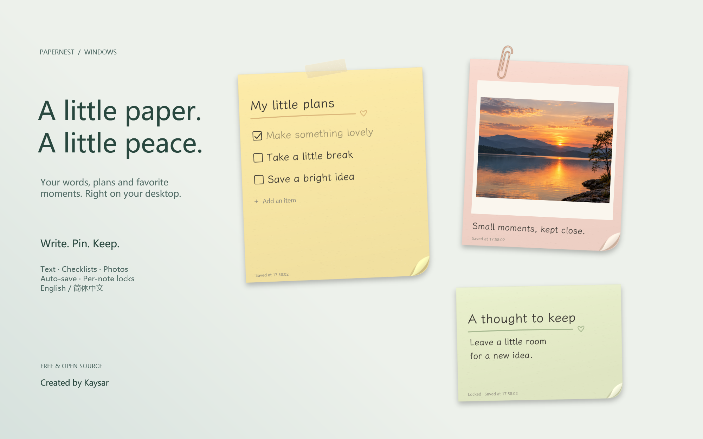
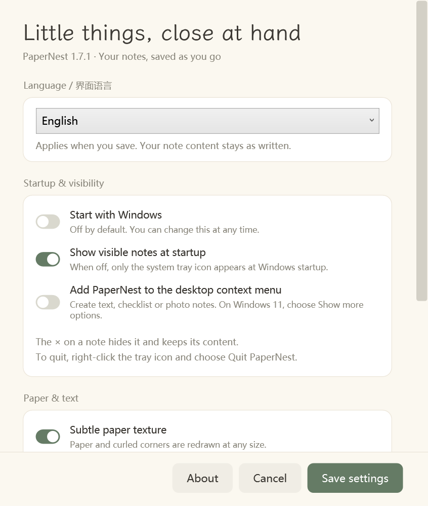
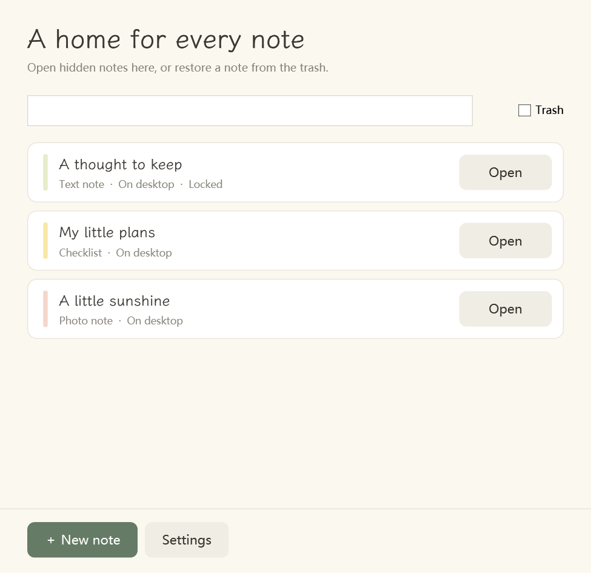

<p align="center"><strong>PaperNest</strong> · Desktop notes with a little paper warmth</p>
<p align="center">English · <a href="README.zh-CN.md">简体中文</a></p>



<p align="center"><a href="https://github.com/CGAtmos/PaperNest/releases/latest"><strong>Download for Windows</strong></a> · <a href="docs/USER-GUIDE.md">User guide</a> · <a href="https://github.com/CGAtmos/PaperNest/issues">Report an issue</a></p>

PaperNest is a small Windows desktop app for keeping words, plans and favorite images close at hand. Soft paper colors, curled corners, tape and paper clips give each note the feel of something you might stick beside your monitor.

Created and designed by **Kaysar**. Free and open source under the [MIT license](LICENSE). The interface supports **English and Simplified Chinese**, with an immediate language switch in Settings.

## A place for the little things

| Feature | What you can do |
| --- | --- |
| Three kinds of paper | Write a text note, tick off a checklist, or pin a photo with a caption. |
| Words and images | Paste text or screenshots, drag in image files, and mix pictures with text. |
| Make it yours | Resize, change colors and decorations, adjust content size, and choose a tilt or a random angle. |
| Always on top | Keep individual notes visible above other windows. |
| Lock a note | Protect its content and position from accidental edits; unlock it whenever needed. |
| Quiet controls | Buttons appear on hover and remain reachable by keyboard. |
| Automatic saving | Save content locally as you work, with drafts, backups and content history. |
| Library and recovery | Reopen hidden notes, restore trashed notes, or recover a past version as a separate copy. |
| Windows integration | Use the system tray, optional startup at sign-in, and an optional desktop right-click menu. |

PaperNest runs locally without an account. It does not upload your notes or include cloud synchronization.

## Install and start

1. Open the [latest release](https://github.com/CGAtmos/PaperNest/releases/latest) and download **PaperNest-Setup-1.7.1.exe** under **Assets**.
2. Run the installer. It installs for the current Windows user and does not require administrator privileges.
3. Choose English or 简体中文. Open PaperNest from the desktop shortcut or Start menu.
4. Write directly on a note. Use **+** or the tray's right-click menu to create another.

**Requirements:** Windows 10 or Windows 11 with .NET Framework 4.8. The installer is currently unsigned. There is no automatic updater; install a newer release over the existing installation to update. Export a backup before an update or a move to another computer.

### A few controls worth knowing

- **Double-click the tray icon:** open the Note Library. Repeated double-clicks reuse the same window; they do not create notes or reveal every hidden note.
- **× on a note:** hide that note and keep its content. Use the library to reopen it.
- **Quit completely:** right-click the tray icon → **Quit PaperNest**.
- **Language:** Settings → Language → English / 简体中文 → Save settings. No restart needed; your own writing stays as written.
- **Always on top / tilt / paper color:** open the note's **⋮** menu.
- **Lock / unlock:** click the lock button or press **Ctrl+L**. This prevents editing; it is not password protection or encryption.
- **Desktop creation menu:** right-click empty desktop space → PaperNest. On Windows 11, this classic menu may appear under **Show more options**.

## Take a closer look

<table>
<tr><td></td><td></td></tr>
<tr><td>Choose your language and how PaperNest starts.</td><td>Open just the notes you need.</td></tr>
</table>

The images are rendered from the app's actual WPF controls with fictional English demo notes. The cover uses a staged background and layout. The included sample sunset is AI-generated. No personal notes or photos are included.

## Saving, backups and recovery

Notes, images, layout and lock states are stored in `%LocalAppData%\PaperNest\Data`.

- Normal editing saves automatically. The small status line on each note shows saving progress or errors.
- Content drafts, atomic file replacement, a previous-state backup and history snapshots provide several recovery paths.
- **Note Library** contains hidden notes and recoverable trash. **Recover Notes** lets you preview a previous version and recover it as a separate note; current content remains intact.
- **Settings → Export backup** creates a backup you can keep elsewhere. This is especially useful before reinstalling Windows or changing computers.
- Uninstalling the app preserves local note data. Local history is not a substitute for a backup on another device.

See the [complete user guide](docs/USER-GUIDE.md) for shortcuts, images, saving and troubleshooting.

## Build from source

PaperNest uses **C# / WPF on .NET Framework 4.8**, with Windows Forms for the tray icon. There is no Electron runtime, Node build step or NuGet dependency restore. Use a Windows machine with the .NET Framework compiler at `C:\Windows\Microsoft.NET\Framework64\v4.0.30319\csc.exe`.

```powershell
powershell -NoProfile -ExecutionPolicy Bypass -File .\build.ps1
powershell -NoProfile -ExecutionPolicy Bypass -File .\test.ps1
powershell -NoProfile -ExecutionPolicy Bypass -File .\package.ps1
```

The app is written to `build\app\PaperNest.exe`; the installer is `build\PaperNest-Setup.exe`. Launch development builds with `--data-dir <a separate folder>` to keep test notes separate from everyday notes.

`test.ps1` uses fresh isolated directories for storage, paste, history, locking, language and tray regressions, including abrupt-exit recovery. `qa.ps1` additionally exercises a temporary installation, IPC, context-menu integration and uninstall using a dedicated QA registry namespace. The installed-app lifecycle test is an explicit, separate opt-in; ordinary tests do not restart your installed app.

The release was checked on the creator's Windows machine; broader Windows versions, accessibility configurations and multi-monitor setups still benefit from community testing.

## Contribute

Bug reports, translation improvements and focused pull requests are welcome. English and Chinese issues are both welcome. Start with [CONTRIBUTING.md](CONTRIBUTING.md) and include your app version, Windows version and steps to reproduce. Please remove private note contents from screenshots and logs.

See [CHANGELOG.md](CHANGELOG.md) for release details and [THIRD_PARTY_NOTICES.md](THIRD_PARTY_NOTICES.md) for font and asset credits. The bundled **LXGW WenKai Lite** font remains under the SIL Open Font License 1.1; it is not relicensed under MIT.

<p align="center">Made with care by Kaysar.</p>
