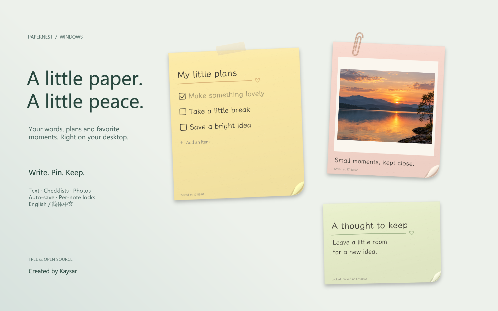
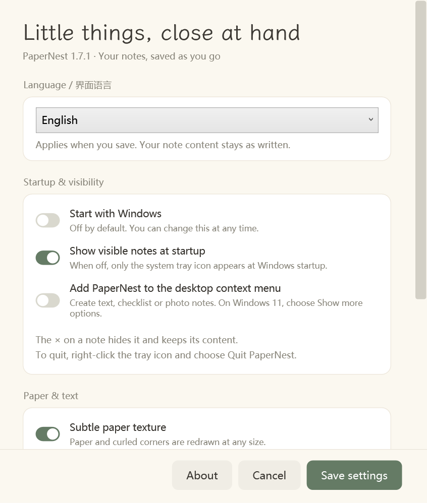

# PaperNest · 纸间

[English](README.md) · 简体中文

把小事，轻轻贴在桌面。纸间是一款 Windows 桌面便签程序，支持文字、待办清单和照片，带有柔和纸色、卷角、胶带与回形针效果。

**作者与设计：Kaysar。** 免费开源，采用 [MIT 协议](LICENSE)。界面可随时切换 English / 简体中文。

## 下载安装

进入 [最新版本下载页](https://github.com/CGAtmos/PaperNest/releases/latest)，展开 **Assets**，下载 **PaperNest-Setup-1.7.1.exe**，双击安装。

支持 Windows 10 / 11，需要 .NET Framework 4.8。安装到当前用户，无需管理员权限。当前安装包尚未签名，不提供自动更新；新版本可覆盖安装，更新前建议导出备份。

## 可以做什么

- 文字、待办、照片三种便签；粘贴截图、拖入图片，文字与图片混排。
- 自由缩放纸片、调整字号、纸色、装饰与斜度，也可以随机倾斜。
- 单张始终置顶、单张锁定，按钮悬停显示。
- 自动保存、本地草稿、历史找回与导出备份。
- 右下角托盘、可选开机启动、桌面右键新建入口。

## 最常用的几个操作

| 操作 | 方法 |
| --- | --- |
| 打开收纳盒 | 双击右下角纸间托盘图标；重复双击不会新建或展开全部便签 |
| 收起一张纸 | 点击 ×，内容保留，在收纳盒里重新打开 |
| 彻底退出 | 右键托盘图标 → 彻底退出纸间 |
| 切换语言 | 设置 → 界面语言 → English / 简体中文 → 保存设置，无需重启 |
| 锁定 / 解锁 | 顶部小锁、右键菜单或 Ctrl+L；锁定是防误改，不是加密 |
| 调整字号 | Ctrl+滚轮，或 ⋮ → 内容大小 |
| 桌面右键新建 | 桌面空白处右键 → 纸间便签；Windows 11 可能需先点“显示更多选项” |

日常编辑自动保存。重新打开程序时保留上次展开的纸片；全部收起时打开收纳盒。收纳盒可恢复废纸篓中的便签，“找回便签”可预览历史版本并恢复为副本，现有内容保留。

数据保存在 `%LocalAppData%\PaperNest\Data`，卸载会保留便签与图片。无需账号，不上传内容，不提供云同步。请在设置中导出备份，并将备份放到其他安全位置。

截图使用真实程序控件和虚构演示便签，封面背景与布局经过编排；示例日落图片由 AI 生成，不包含个人工作内容。

完整操作、开发与测试说明见 [使用指南](docs/USER-GUIDE.md)、[英文首页](README.md) 与 [贡献说明](CONTRIBUTING.md)。欢迎用中文或英文提交问题。字体 LXGW WenKai Lite 单独遵循 SIL Open Font License 1.1，详见 [第三方说明](THIRD_PARTY_NOTICES.md)。
